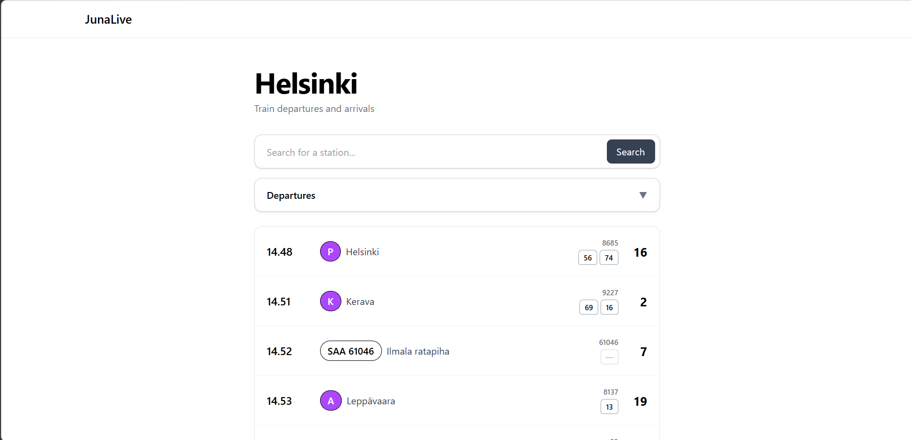

# JunaLive

Live train departures and arrivals for Finnish stations. Shows platform, delays, cancellations, train number (runkolinja) and wagon numbers at a glance.




## Features

- Search for any station by name or short code (e.g. `Helsinki`, `HKI`)
- Departures and arrivals view
- Live delays and cancellations, refreshed every 30 seconds
- Train number (runkolinja) and wagon numbers per train
- Colored line badges for commuter trains (purple for HSL lines, green for VR commuter lines)


## Tech stack

- React
- Tailwind CSS
- React Router
- Data: [Digitraffic](https://www.digitraffic.fi/en/railway-traffic/) (Fintraffic open rail API)


## Project structure

```
src/
  api/
    digitraffic.js    # fetch helpers and station lookup
    mapTrains.js      # API response -> UI model, wagon number parsing   
  hooks/
    apiHooks.js       # useStations, useLiveTrains, useWagons
  utils/
    fetchData.js
    trainColors.js    # HSL / VR line badge colors
  views/
    Home.jsx
    Station.jsx
```